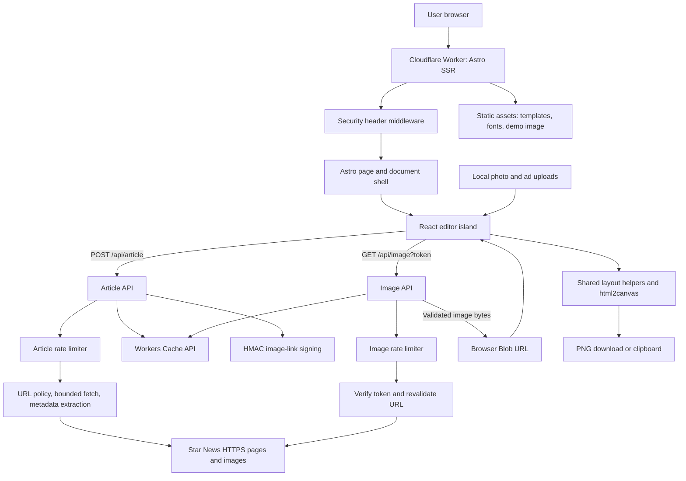
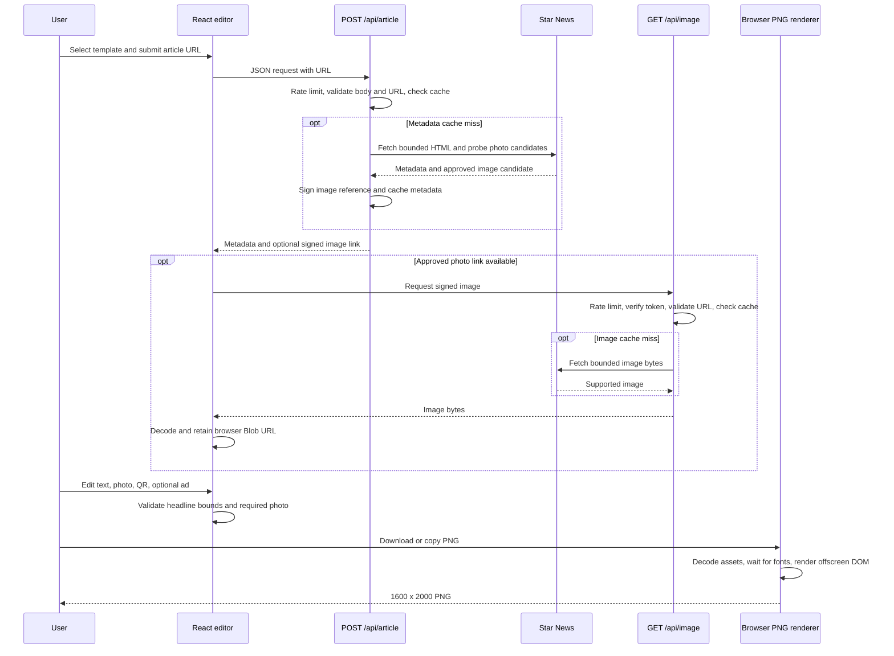

# Star News Photocard Generator

Create editable Star News article and custom cards, preview branded layouts, and export a 1600 x 2000 PNG entirely in the browser.

## Features

- Seven portrait templates: five article layouts and two custom layouts, each with an advertisement artwork variant.
- Article headline, approved photo and category fetched from Star News; content remains editable.
- Today's Bengali date in Asia/Dhaka, filled after hydration, without a leading zero. The card uses the editable current date, not the article's publication date.
- Self-hosted Bengali/English card fonts, headline highlighting, a 30-120px size dropdown and a **Fit headline** action. Overflow blocks export.
- Photo upload, bounded drag/zoom, photo-credit presets and a **Show whole photo (no crop)** toggle. Templates default to `cover`; the toggle selects `contain` in preview and export.
- Optional advertisement strip with an uploaded creative; recommended artwork size is **1600 x 148 pixels**. Ad mode stays off until a creative is provided, and the final card remains 1600 x 2000 pixels.
- Optional QR codes, PNG download and clipboard copy where supported. Keyboard shortcuts are enabled by default and can be disabled with the checkbox.

Built with Astro SSR on Cloudflare Workers, a React editor island, TypeScript, html2canvas, Vitest, Playwright and Wrangler.


Reviewed against repository source on **November 9, 2026**. This document describes the implemented system; remote Worker names, active secrets, and live deployment status require confirmation in the deployment account.

## Contents

- [Features](#features)
- [Architecture blueprint](#architecture-blueprint)
- [Quickstart](#quickstart)
- [Commands](#commands)
- [Templates](#templates)
- [Configuration](#configuration)
- [Deployment](#deployment)
- [Testing](#testing)
- [Project structure](#project-structure)
- [Security notes](#security-notes)
- [Troubleshooting](#troubleshooting)
- [License and contributing](#license-and-contributing)

## Architecture blueprint

### Runtime and ownership

This is a stateless **Astro SSR application on Cloudflare Workers**, with a React editor island hydrated using `client:load`. Astro serves the document shell and API routes; React owns the interactive composition. PNG rendering runs in the browser, rather than on a server.

There is no application database, account system, saved-project service, or server-side image-rendering queue. Astro sessions are disabled. Article metadata and approved remote images use the Workers Cache API as a best-effort performance layer; it is not durable project storage. Uploaded photos and advertisement creatives remain browser-local Blob URLs.



The diagram shows responsibilities, not exact execution order. Each route applies its limiter before reading or fetching content; the image route verifies its token before looking up image bytes in cache.

### Component map

| Component | Responsibility | Source |
| --- | --- | --- |
| Astro shell | SSR entry, signing readiness, React hydration | [index.astro](src/pages/index.astro), [AppLayout.astro](src/layouts/AppLayout.astro) |
| Editor | Forms, generation/cancellation, uploads, drag/nudge, preview, export feedback | [PhotocardEditor.tsx](src/components/editor/PhotocardEditor.tsx), [Controls.tsx](src/components/editor/Controls.tsx) |
| State model | Immutable card state, reducer actions, template defaults, reset behavior | [types.ts](src/lib/card/types.ts), [reducer.ts](src/lib/card/reducer.ts) |
| Template registry | Seven base layouts, ad variants, layer bounds, export dimensions | [templates.ts](src/config/templates.ts) |
| Shared rendering | Photo geometry, text/QR/ad styling, headline bounds, renderer interface | [geometry.ts](src/lib/card/geometry.ts), [layerStyles.ts](src/lib/card/layerStyles.ts), [titleBounds.ts](src/lib/card/titleBounds.ts), [renderer.ts](src/lib/card/renderer.ts) |
| PNG renderer | Decode assets, wait for fonts, build offscreen DOM, render PNG Blob | [html2canvasRenderer.ts](src/lib/card/html2canvasRenderer.ts) |
| Article pipeline | URL normalization, inert HTML extraction, image candidate probing | [article.ts](src/pages/api/article.ts), [extractArticle.ts](src/lib/article/extractArticle.ts) |
| Image pipeline | Signed-token verification, URL revalidation, bounded image delivery | [image.ts](src/pages/api/image.ts), [imageToken.ts](src/lib/security/imageToken.ts) |
| Runtime safeguards | Request limits, fail-closed rate limiting, bounded outbound requests, hashed cache keys | [security](src/lib/security), [middleware.ts](src/middleware.ts) |
| Deployment | Environment selection, generated-config validation, Worker deployment | [environment.mjs](scripts/environment.mjs), [wrangler.jsonc](wrangler.jsonc) |

### Article-to-card sequence



Custom cards skip the article API. Just In requires a local photo; Breaking News uses no main photo. Missing/rejected article candidates can use the bundled demo image, but failure to download an approved photo reports an error and preserves the current composition.

### Preview and export contract

The registry defines geometry in **1080 x 1350 layout units**, scaled from **1600 x 2000 artwork pixels**. React preview and the offscreen renderer share geometry and layer-style helpers. The export renderer captures an immutable snapshot, resolves the normal/ad template variant, checks required assets and headline bounds, and produces a PNG at the fixed export size.

Advertisement mode changes the artwork and selected layout coordinates while reserving a bottom strip. A creative upload enables it; switching it off restores the normal variant without changing the export dimensions. Keep geometry in the registry rather than introducing independent preview/export coordinates.

### API contract

| Endpoint | Input | Success | Key failure behavior |
| --- | --- | --- | --- |
| `POST /api/article` | JSON object containing only `url`; trimmed string up to 2048 characters | `{ data: { canonicalUrl, title, category, publishedAt, formattedDate, dateSource, language, imageUrl?, imageNotice? } }` | Structured `{ error: { code, message, requestId } }`; validation, upstream, size, timeout, and limiter failures |
| `GET /api/image?token=...` | Signed article-image reference | Validated image bytes and content headers | Invalid token 400/403, missing signing configuration 500, upstream image failure 502; limiter failures 429/503 |

Article responses use `Cache-Control: no-store` for clients while metadata is cached internally. Image tokens are signed, not encrypted; they authorize bounded retrieval of a validated URL and do not represent a user session. Neither endpoint accepts arbitrary third-party image hosts.

## Quickstart

Requires Node.js **22.12.0 or newer**, npm **9.6.5 or newer**, and Git. A Cloudflare account is needed for deployment, not local development. On Windows PowerShell, use `npm.cmd` / `npx.cmd` if execution policy blocks `npm` / `npx`.

```sh
git clone https://github.com/DelwarOfficial/star-photocard.git
cd star-photocard
npm ci
```

Create `.dev.vars` with a fresh local signing secret; this command overwrites that file, so use it only for initial setup:

```sh
node -e "require('node:fs').writeFileSync('.dev.vars', 'IMAGE_TOKEN_SECRET=' + require('node:crypto').randomBytes(32).toString('hex') + '\n')"
npm run dev
```

Open **http://localhost:4321** (or the URL printed by Astro).

1. Select an article template, paste an HTTPS Star News article URL and click **Generate**.
2. Edit the headline, date and category. Replace the photo with a local upload if needed. Use **Fit headline** if overflow prevents export. Optionally upload an advertisement creative in the layout controls to enable the ad strip.
3. Click **Download PNG** for a 1600 x 2000 image. **Copy PNG** requires a supported clipboard API and a secure context.

For a card without an article, select **Just In**, upload a photo and enter a headline; or select **Breaking News** and enter a headline. No article fetch is needed in custom mode.

## Commands

Run these from the repository root. Publishing commands require Cloudflare authentication and change the selected remote Worker.

| Command | Purpose |
| --- | --- |
| `npm run dev` | Astro development server, normally port 4321 |
| `npm run check` | Astro and TypeScript diagnostics |
| `npm test` | Vitest unit and Workers integration tests |
| `npm run test:watch` | Watch mode for Vitest |
| `npm run lint` | TypeScript ESLint; warnings fail the command |
| `npm run build` | `astro check`, then `astro build` for the default environment |
| `npm run preview` | Build, then local Wrangler dev server, normally port 8787 |
| `npm run test:e2e` | Playwright; starts a build and local Worker on port 8788 |
| `npm run cf-typegen` | Regenerate `worker-configuration.d.ts` from Wrangler configuration |
| `npm run build:staging` | Select staging before build; validate generated Worker name and limiter namespaces |
| `npm run build:production` | Select production before build; validate generated configuration |
| `npm run deploy:staging` | Build and validate staging, then publish it |
| `npm run deploy:production` | Build and validate production, then publish it |

The generic `npm run deploy` script also exists; use the environment-specific scripts for staging and production.

## Templates

The registry is [`src/config/templates.ts`](src/config/templates.ts). Layout coordinates are **1080 x 1350**; [`html2canvasRenderer.ts`](src/lib/card/html2canvasRenderer.ts) produces **1600 x 2000** output. Both use a 4:5 aspect ratio.

| Template ID / label | Mode | Photo | QR | Meta rows |
| --- | --- | --- | --- | --- |
| `common-card` / Photo on top | Article | Upper window | Yes | 3 |
| `common-card-without-details` / Photo on top (no category) | Article | Upper window | Yes | 2 |
| `common-card-bottom` / Photo at bottom | Article | Lower window | Yes | 3 |
| `special-card-top` / Full photo, headline on top | Article | Full card | Yes | 3 |
| `special-card-bottom` / Full photo, headline at bottom | Article | Full card | Yes | 3 |
| `just-in` / Just In | Custom | Upper window; upload required | Yes | 2 |
| `breaking-news` / Breaking News | Custom | None | Yes | 2 |

Three-row meta stacks show the site address, date and comment-link label; two-row stacks show the site address and date. **Just In currently includes a QR code**, as defined in the registry. QR visibility can be toggled.

Article QR codes use the canonical URL's origin and first two path segments: `https://starnews.com.bd/country/25819/long-slug.html` becomes `https://starnews.com.bd/country/25819`. Custom cards encode `https://starnews.com.bd`.

Category extraction tries `article:section`, then JSON-LD `articleSection`, then a validated menu/section anchor matching the article's section. The dropdown supports presets, custom text and restoring the article category. Manual overrides survive regeneration. Only **Photo on top** and **Photo at bottom** render the editable category pill; Just In has a baked label.

An article uses the approved article photo when available; a local upload replaces it. Missing/rejected article candidates or unconfigured signing use [`public/photos/Star-news-file-image.webp`](public/photos/Star-news-file-image.webp). A failed download of an approved photo reports an error and preserves the current composition. Successfully downloaded article bytes stay in a browser Blob URL, so later token expiry does not break export. Just In still requires an upload; the demo does not satisfy that requirement.

Fonts in `public/fonts/` are `StarNews-SemiBold-V1.5`, `StarNews-Bold-V1.5` and `StarNews-Black-V1.5`, each with `.woff2` and `.woff` files. `StarBangla` and `StarEnglish` map to these faces at weights 600, 700 and 900. Editable card text uses **SemiBold 600**; editor controls use system fonts. Fonts load locally, without a font CDN.

## Configuration

[`wrangler.jsonc`](wrangler.jsonc) defines Worker names, assets, rate limiters and non-secret variables. [`.dev.vars.example`](.dev.vars.example) documents the local secret. `.dev.vars` is ignored by Git; never commit credentials.

| Setting | Default / requirement | Use |
| --- | --- | --- |
| `IMAGE_TOKEN_SECRET` | Random secret, at least 32 characters | HMAC signing for article photos; `.dev.vars` locally, Worker secret remotely |
| `ARTICLE_CACHE_TTL_SECONDS` | `300` | Article metadata cache; capped at the image-token lifetime of 600 seconds |
| `IMAGE_CACHE_TTL_SECONDS` | `900` | Validated image cache |
| `CLOUDFLARE_ENV` | Unset for default; `staging` or `production` | Selects the Cloudflare environment **before** Astro builds |
| `PLAYWRIGHT_BASE_URL` | Unset | Optional existing test-server URL; when set, Playwright does not start its own server |

The cache TTL variables live in each environment's `vars`; they are not secrets. Valid TTL values are integers from 1 to 86400 seconds; invalid values use the code defaults. Tokens last 600 seconds, with a 30-second verification allowance.

Both named environments currently limit article requests to **10 per 60 seconds** and image requests to **60 per 60 seconds**, keyed by client address. Limiter namespaces are isolated:

| Environment | Worker name | Article namespace | Image namespace |
| --- | --- | --- | --- |
| Default | `star-news-photocard` | `1001` | `2001` |
| Staging | `star-news-photocard-staging` | `1002` | `2002` |
| Production | `star-news-photocard-production` | `1003` | `2003` |

After changing bindings, run `npm run cf-typegen`.

## Deployment

Authenticate once, then build, configure the secret and publish staging:

```sh
npx wrangler login
npm run build:staging
npx wrangler secret put IMAGE_TOKEN_SECRET --env staging
npm run deploy:staging
```

Enter a separate random staging secret at the prompt. Verify the deployed card generation, image delivery and PNG export before publishing production:

```sh
npm run build:production
npx wrangler secret put IMAGE_TOKEN_SECRET --env production
npm run deploy:production
```

Use a separate production secret. The deployment scripts rebuild and validate before publishing. [`scripts/environment.mjs`](scripts/environment.mjs) sets `CLOUDFLARE_ENV` before both Astro commands, checks `dist/server/wrangler.json` for the expected Worker name and named limiter namespaces, then invokes Wrangler only for a deploy action. Do not build the default environment and select staging only at deploy time.

### Required secret: `IMAGE_TOKEN_SECRET` (every environment)

Article photos are served only through signed `/api/image` links. **Without this secret the app still runs, but every article card falls back to the demo photo**, and the editor shows "Article photos are turned off on this server" on page load. Set a different random value (at least 32 characters) in each environment:

```sh
openssl rand -hex 32   # or: node -e "console.log(require('crypto').randomBytes(32).toString('hex'))"
```

| Environment | Worker | Command |
| --- | --- | --- |
| Staging (`wrangler.jsonc` → `env.staging`) | `star-news-photocard-staging` | `npx wrangler secret put IMAGE_TOKEN_SECRET --env staging` |
| Production (`wrangler.jsonc` → `env.production`) | `star-news-photocard-production` | `npx wrangler secret put IMAGE_TOKEN_SECRET --env production` |
| Local dev / `npm run preview` | — | `.dev.vars` (see Quickstart) |
| CI | — | the workflow writes a throwaway `.dev.vars` per run |

For an externally configured Worker name (for example, one selected in Workers Builds), confirm the actual name in Cloudflare before setting secrets. Use `npx wrangler secret put IMAGE_TOKEN_SECRET --name <actual-worker-name>` and `npx wrangler secret list --name <actual-worker-name>` for that target. The repository configuration alone does not establish which Worker currently serves a live domain.

The app deploys to **Cloudflare Workers**, with static assets and SSR/API routes, not Cloudflare Pages. Current configuration uses compatibility date `2026-09-04`, `nodejs_compat`, and observability. The GitHub CI workflow validates changes; it does not deploy them.

## Testing

```sh
npm run check
npm run lint
npm test
npm run build
npx playwright install --with-deps chromium
npm run test:e2e
```

Use the local `.dev.vars` secret created during quickstart. E2E tests use desktop Chromium and Pixel 7 emulation against Wrangler's local Workers runtime on `127.0.0.1:8788`. They cover editing, QR targets, image fit, fallback, cancellation, overflow, responsive layout and PNG output. Most article journeys mock the API. `live-article.spec.ts` additionally exercises a real Star News article and skips with a reason when the upstream site is unreachable; a skipped live check does not establish upstream availability.

Vitest runs `tests/unit/` and `tests/integration/`. Integration tests execute the actual route handlers and Cache API in Miniflare with mocked outbound requests. `.github/workflows/ci.yml` runs checks, lint, Vitest and build, followed by Playwright with a throwaway secret on pushes to `main` and pull requests. Failed browser runs upload `playwright-report/` as an artifact; local failure details are also in `test-results/`.

## Project structure

```text
src/components/editor/  React editor and controls
src/config/             Template registry and layout geometry
src/layouts/            Astro document shell and favicon
src/pages/              Entry page and article/image API routes
src/lib/article/        URL policy and inert HTML extraction
src/lib/card/           State, shared geometry/styles and PNG renderer
src/lib/security/       Bounded fetch, tokens, caches and request limits
src/lib/text/           Date formatting
src/lib/i18n/           Editor and API copy
src/styles/             Fonts, design tokens and responsive UI
public/templates/       Template artwork
public/fonts/           Self-hosted StarNews fonts
public/photos/          Demo photo and favicon.png
scripts/                Environment-specific build/deploy validation
tests/                  Unit, Workers integration and browser tests
```

## Security notes

- Article and remote-image requests require HTTPS without URL credentials, on `starnews.com.bd` or a true subdomain. Every redirect is revalidated; at most three redirects are allowed.
- Image delivery requires a verified HMAC-SHA-256 token. MIME and image signatures are checked; full image downloads are limited to 8 MiB. Supported formats are JPEG, PNG, WebP and GIF; GIF export is a static decoded frame.
- Article HTML reads are capped at 2 MiB. A truncated page is accepted only if its complete `head` was received. Article image selection probes at most four candidates, with a 5-second timeout each; normal outbound fetches use a 10-second timeout per hop.
- The article endpoint limits the streamed JSON body to 8 KiB and rate-limits before parsing. The image endpoint has a separate limiter. Denials return 429; missing/failing limiter bindings return 503. Rate limiting is abuse protection, not exact accounting.
- `src/middleware.ts` sets CSP, `nosniff`, `SAMEORIGIN` framing, a no-referrer policy and restrictive permissions. CSP currently allows inline scripts/styles for the editor and Astro island bootstrap.
- Cache keys hash complete URLs, preserving path/query case. Uploaded images stay in the browser. Workers do not expose portable connected-IP/DNS pinning; host validation is not an IP-pinning guarantee.

## Troubleshooting

| Symptom | Action |
| --- | --- |
| Article has a demo photo / signing warning | Set `IMAGE_TOKEN_SECRET` to at least 32 random characters in the correct environment; restart local dev. Cached metadata may retain the fallback until its TTL expires. |
| Approved article photo fails to load | Generate again or upload a supported image up to 8 MiB. An approved-image failure is reported rather than silently exporting a different photo. |
| No category on the card | Extraction may find none, or the layout has no editable pill. Use a preset/custom category on Photo on top or Photo at bottom. |
| Download is disabled | Enter a headline, resolve overflow with Fit headline/editing, wait for generation, and upload a photo if using Just In. |
| Clipboard copy is unavailable or blocked | Use Download PNG; copy requires a secure context, supported browser APIs and permission. |
| API returns 429 | Wait for the 60-second rate window before retrying. |
| API returns 503 | Check that both rate-limiter bindings exist in the selected environment and inspect Worker logs. |
| URL is rejected | Use an absolute HTTPS Star News URL without credentials; off-host redirects are rejected. |
| Playwright cannot start its server | Run `npm run build` to expose diagnostics, check port 8788, install Chromium and confirm `.dev.vars` exists. |
| Wrong Worker targeted for deployment | Use the named build/deploy script; confirm its validation output before publishing. |
| `npm ci` reports EBUSY on Windows | Stop workspace dev servers holding dependencies open, rerun installation, then restart dev. |

## Author

Built by [Delwar Hossain](https://delwarhossain.net).

## License and contributing

No project-level license file is currently included. `package.json` marks this project private; it does not grant redistribution rights. Star News branding and bundled font/artwork rights require separate consideration.

For changes, keep layout geometry in the template registry and preview/export behavior aligned through shared helpers. Add regression coverage for behavioral changes, run the testing commands above, and open a pull request describing the change and validation. Keep local secrets and generated build/test artifacts out of commits.
